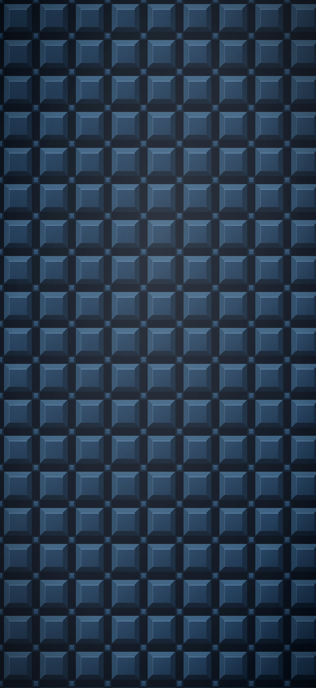
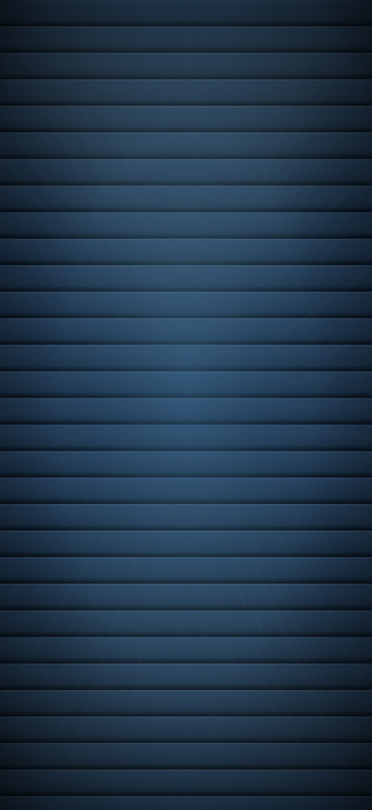
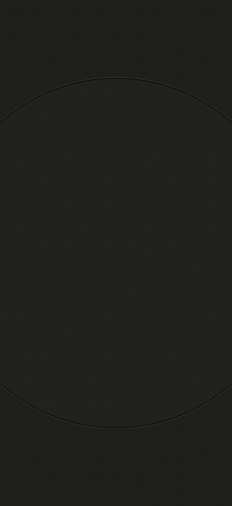

# ⌚🎨 WatchPaper

Wallpapers that match the watch on your wrist. Pick the watch you're wearing
today and your lock screen matches it: the dial reduced to pure texture and
colour, with no logos, no indices and no hands, sized for your phone.

**▶ [Open WatchPaper →](https://watchpaper.vercel.app)** — on your phone; add
it to your home screen and it opens like an app.

<p align="center">
  
  
  
  
  
</p>

The wallpapers are original artworks inspired by dial **finishes**
(guilloché, embossing, sunray brushing, lacquer, silvered relief), drawn as
vector art, so they stay sharp at any resolution.

## Features

| Feature | What you get |
| --- | --- |
| **Ten built-in dials** | Original textures such as Octagon Bleu, Porthole Blue, Emerald Sunray and First Snow, each noting which watch it pairs with. |
| **Find your watch** | Pick brand, model, movement and dial colour from a catalog of 171 dial variants (15 brands, 39 models). Every variant maps to a finish and a palette, so picking the watch draws the wallpaper. |
| **Photo studio** | Photograph your watch or choose a photo, frame the dial in the circle, then pick a style: **Showcase** (your dial, floating), **Macro** (the dial, full bleed) or **Re-draw** (a texture in its colours, drawn in any finish family). |
| **Dial cleaner** | On by default in the studio: removes hands, text and subdials from your photo and keeps only the dial surface. |
| **Seven finish families** | Sunray, Lacquer, Tapisserie, Embossed bars, Snow relief, Matte grain, Engine turning. |
| **Live preview** | The wallpaper under a lock-screen clock showing the current time, with dark ink on light dials. |
| **Exact-size save** | A PNG at your device's exact resolution, or 1179 × 2556, 1320 × 2868 or 1440 × 3200. |
| **One-tap set on iOS** | A two-action Shortcut sets the lock screen without going through Photos, and works in Time-of-Day automations. |
| **Private by design** | No account, no database, no tracking. Your collection lives in the browser; photos are processed on the phone and never uploaded. |

## Use

1. Open [watchpaper.vercel.app](https://watchpaper.vercel.app) on your phone
   and build your collection (**Edit collection**): tick the built-in dials
   you own, **find your watch** in the catalog, or **photograph it** in the
   studio.
2. Tap the watch you're wearing. The preview shows it under a live clock.
3. Tap **Save wallpaper**. On iOS that opens the share sheet: choose **Save
   Image**, then set it as your lock screen from Photos. Other browsers
   download the PNG.

**Set it in one tap with iOS Shortcuts.** Once, in the Shortcuts app, create a
shortcut named **WatchPaper** with two actions:

1. **Get Contents of URL**, with its URL set to the *Shortcut Input* variable
2. **Set Wallpaper Photo**, set to Lock Screen with "Show Preview" off

Then **Set wallpaper via Shortcut** in the app changes your lock screen
directly. For a daily automation, copy the dial's wallpaper URL from the same
panel into a Time-of-Day automation with the same two actions. Photo
wallpapers can't be set this way: they never leave your phone, so there's no
URL a Shortcut could fetch.

## Wallpaper API

```
GET /api/wallpaper?dial=octagon-bleu&w=1179&h=2556
GET /api/wallpaper?family=sunray&colors=143723,3ca463&w=1179&h=2556
```

Returns a PNG rendered on the server, cover-cropped to `w` × `h`. Use `dial`
for a built-in (its slug), or `family` plus one to three hex `colors` (no `#`)
for a custom one. Families: `sunray`, `lacquer`, `tapisserie`, `stripes`,
`snow`, `grain`, `guilloche`. The output depends only on the query, so it is
cached as immutable; an unknown dial or family returns `400`.

## How it works

Next.js 15 (App Router), React 19 and TypeScript, with one server route. The
moving parts:

1. **The generator** ([lib/generator.ts](lib/generator.ts)) is the single
   source of truth: seven palette-driven finish families draw the built-in
   dials, the catalog and photo-derived dials, and the server PNGs, all on a
   1320 × 2868 master artboard.
2. **The catalog** ([lib/catalog.ts](lib/catalog.ts)) runs brand → model →
   movement/type → dial variant, and every variant is a finish family plus a
   palette. Built-in dial metadata lives in [lib/dials.ts](lib/dials.ts).
3. **Saving** draws the vector or photo master onto a canvas at the target
   size, cover-cropped, and exports a PNG in the browser.
4. **The photo studio** ([lib/compose.ts](lib/compose.ts)) runs entirely on
   canvas. Re-draw extracts the dial's palette with k-means. The dial cleaner
   treats hands, printing and subdials as outliers against the median colour
   at each radius and refills them from the same radius at clean angles, so
   gradients and sunray textures survive. Photo wallpapers are kept in
   IndexedDB; everything else (your collection, custom dials) in
   `localStorage`.
5. **The API route** ([app/api/wallpaper/route.ts](app/api/wallpaper/route.ts))
   renders the same SVG with resvg, which is what lets an iOS Shortcut fetch a
   real image URL.

## Run locally

```bash
npm install
npm run dev          # http://localhost:3000
npm run typecheck
npm run build && npm start
```

No environment variables are needed.

Design tooling:

- `npx tsx scripts/gen-dials.ts` regenerates `public/dials/` from the
  generator. The output is byte-identical, so `git diff public/dials/` should
  stay empty.
- `npx tsx scripts/test-resvg.ts` renders every built-in dial with resvg and
  compares sampled pixels against references measured in the browser.
- `npx tsx scripts/contact-sheet.ts` renders every catalog variant into
  `contact.html`, for reviewing the palettes side by side.
- `design/` holds the original Node design study (`gen.js`,
  `build_gallery.js` → `gallery.html`) and the app icon.

## On the naming

The wallpapers are original artworks inspired by dial finishes. Watch model
names are used solely to identify which watch a wallpaper pairs with;
WatchPaper is not affiliated with, or endorsed by, any watchmaker. Keep brand
names out of any app-store metadata and marketing copy.
